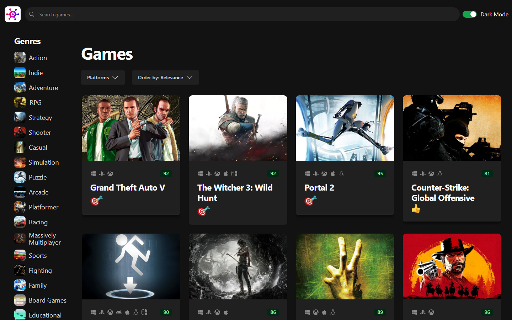
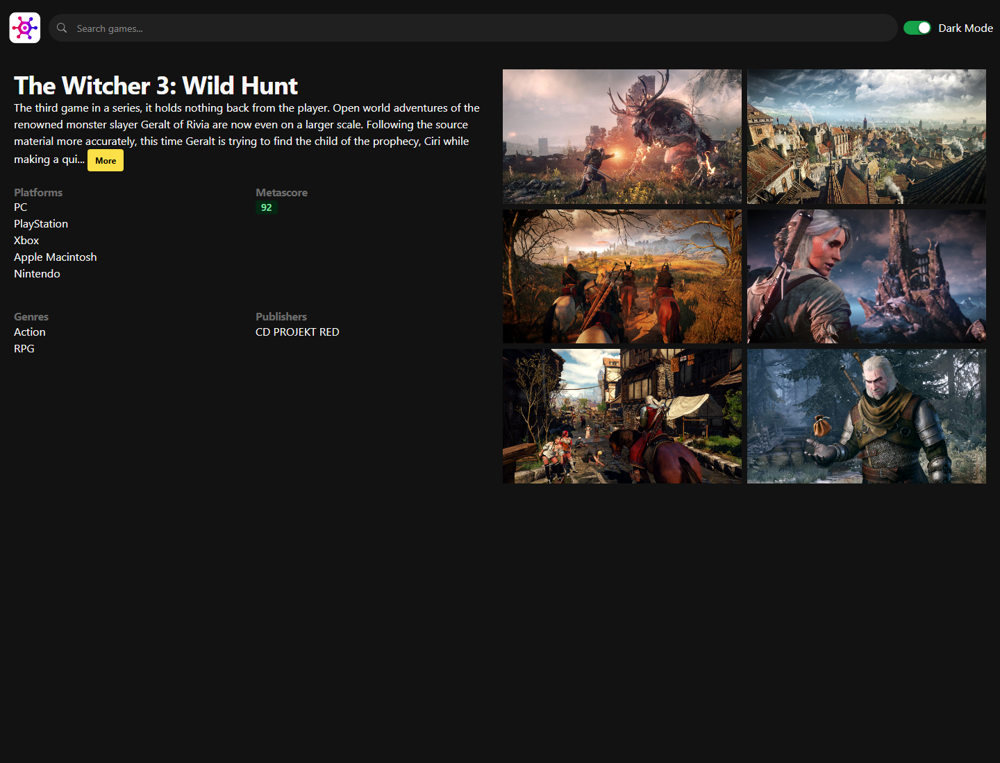

# GameHub: React + Chakra UI Game Browser

Browse, search and filter thousands of video games, using data from the [RAWG Video Games Database API](https://rawg.io/apidocs) and a UI built with [Chakra UI](https://chakra-ui.com/).

**Live demo:** <https://felstar.com/demo/gamehub/>



## Features

- **Infinite scrolling** game grid with cover art, platform icons, Metacritic score and a rating emoji
- **Filter** by genre and platform, **sort** by relevance, date added, name, release date, popularity or average rating
- **Search** games by name
- **Game detail page** with an expandable description, platforms, genres, publishers, a trailer (when available) and screenshots
- **Dark / light mode** toggle (dark by default)
- **Responsive layout**: the genre sidebar hides on small screens
- **Fast first load**: genre and platform lists ship with the app and are cached for 24 hours



## Tech stack

| Area | Library |
| --- | --- |
| UI framework | [React 19](https://react.dev/) + [TypeScript 7](https://www.typescriptlang.org/) |
| Components & theming | [Chakra UI 3](https://chakra-ui.com/) |
| Data fetching & caching | [TanStack Query 5](https://tanstack.com/query) + [axios](https://axios-http.com/) |
| Global state | [Zustand 5](https://zustand.docs.pmnd.rs/) |
| Routing | [React Router 7](https://reactrouter.com/) (hash routing) |
| Build tool | [Vite 8](https://vite.dev/) |
| Linting | [Oxlint](https://oxc.rs/docs/guide/usage/linter) |

## Getting started

Requires **Node.js 20.19+ or 22.12+** (needed by Vite 8).

```bash
npm install
cp .env.example .env   # then add your RAWG API key
npm run dev
```

Then open the URL Vite prints (usually <http://localhost:5173>).

### RAWG API key

The app needs a free RAWG API key from <https://rawg.io/apidocs>. Copy [.env.example](.env.example) to `.env` and fill it in:

```bash
RAWG_API_KEY=your-rawg-api-key
```

`.env` is git-ignored. Vite is configured to expose `RAWG_*` variables to the app (see `envPrefix` in [vite.config.ts](vite.config.ts)), and [src/services/api-client.ts](src/services/api-client.ts) reads the key from `import.meta.env.RAWG_API_KEY`.

> Note: this is a client-side app, so the key is still inlined into the built JavaScript and visible to anyone using the site. Keeping it out of the repo is good hygiene, not a way to make it secret.

## Scripts

| Command | What it does |
| --- | --- |
| `npm run dev` | Start the dev server with hot reload |
| `npm run build` | Type-check with `tsc`, then build for production into `dist/` |
| `npm run preview` | Serve the production build locally |
| `npm run lint` | Lint with Oxlint (fails on warnings) |

### Deploying under a subdirectory

To serve the app from a path other than the site root, set Vite's base path:

```bash
npx vite build --base=/subdir1/subdir2/
```

The app uses hash routing (`/#/games/...`), so no server rewrite rules are needed.

## Project structure

```text
src/
  components/   UI components (game grid, cards, selectors, navbar...)
    ui/         Chakra CLI snippets: Provider and color mode (next-themes)
  pages/        Route pages: Layout, HomePage, GameDetailPage, ErrorPage
  hooks/        React Query hooks: useGames, useGame, useGenres, usePlatforms...
  services/     axios API client and image URL helper
  entities/     TypeScript models for RAWG data
  data/         Bundled genre and platform lists (initial query data)
  store.ts      Zustand store for the current search, filters and sort order
  routes.tsx    Route definitions
  theme.ts      Chakra system (createSystem: custom gray palette, v2-style tokens)
```

## Tutorial

A chapter-by-chapter walkthrough of how the app is built: [Tutorial](tutorial/index.md)
